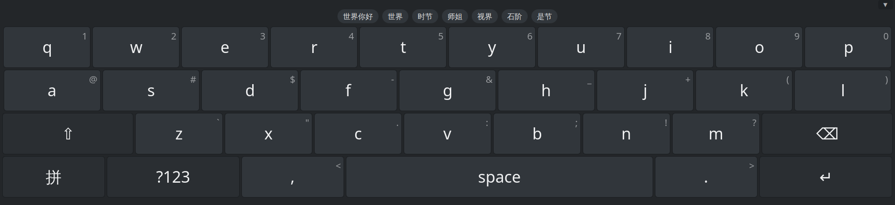
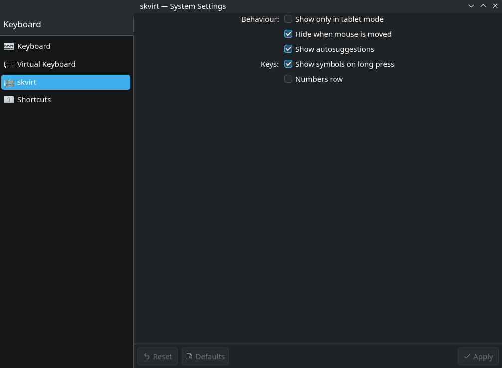

# skvirt

A touch-driven on-screen keyboard for **KDE Plasma / KWin (Wayland)** that works
**with** fcitx5 instead of replacing it.

Unlike input-method-based on-screen keyboards, skvirt does not take over the
Wayland input-method slot and does not put fcitx5 into its virtual-keyboard
mode. It types by creating a **kernel virtual keyboard via `/dev/uinput`**, so
key taps travel the normal input path — libinput → KWin → fcitx5 — exactly like
a physical keyboard. Your active fcitx5 layout and engine (e.g. `keyboard-ru`,
Pinyin) compose the input and show candidates in fcitx5's usual window, and the
fcitx5 tray icon keeps working. fcitx5 never even knows skvirt exists.



## Features

- **macOS-style panel and key set:** the layout of a Mac keyboard — number row,
  the three letter rows framed by `tab` / `caps lock` / `shift` / `return` /
  `delete`, and a bottom row of 🌐 `⌃` `⌥` `⌘` space `⌘` `⌥` plus the
  inverted-T arrow cluster — drawn as a floating slab with square caps, in a
  **light or dark** appearance that can follow the system colour scheme.
  `⌃` `⌥` `⌘` latch like the one-shot Shift: tap one, and the next key is sent
  with it held. 🌐 switches the input source (the fcitx5 IM), and `caps lock`
  has its indicator light.
- **Touch-driven, Windows-like:** touching a text field with a finger/pen pops
  the keyboard up; reaching for the mouse/touchpad/trackpoint, losing the field,
  or pressing the ▼ button hides it. A mouse click never summons it — unless
  *show automatically* is turned on, then any activated field does.
- **Multi-monitor aware:** the keyboard appears on the screen where the event
  that summoned it happened — the touched screen for a finger/pen, the
  pointer's screen for a mouse click or the tray icon — not on whichever
  output the compositor currently considers active.
- **Coexists with fcitx5:** input goes through fcitx5, so layouts, composing and
  CJK candidate selection all work normally.
- **Autosuggestion bar:** word completions above the key rows — Hunspell
  dictionaries for Latin/Cyrillic layouts, and **libime pinyin candidates**
  (the same engine and data as fcitx5-pinyin) when a Chinese IM is active.
  Tapping a pinyin candidate commits the hanzi directly.
- **Voice input via whisper.cpp (optional):** tap `space`, then press-and-hold
  it to dictate — recording runs while you hold, releasing transcribes and
  types the text. Talks over HTTP to a `whisper-server` (default
  `http://127.0.0.1:8080`); with no server running the 🎤 corner hint on the
  space bar stays hidden and the gesture only shows a short note.
- **Layout generator:** the on-screen rows are generated at runtime from the
  active IM's xkb symbols (`/usr/share/X11/xkb/symbols/*`), so any
  `keyboard-XX` layout (de, fr, …) shows the right legends on all four typing
  rows, dead keys (`^` `´` `¨`) included. Hardcoded QWERTY/ЙЦУКЕН remain as
  fallback.
- **Long-press symbols:** holding a key opens an alternates strip — the
  digit/symbol of its physical position first (`1` on `q`, `@` on `a`, `?` on
  `m`), then the accented variants of the letter on the cap (à á â ä, ё/й, …).
  Slide to pick, release to type. What a key hides is printed small in its
  corner, so the strip is not a secret.
- **Optional function row** — `esc` and F1–F12 across the top. With it off, the
  same keys stay reachable by holding the key below them (and are shown in that
  key's corner): hold `` ` `` for `esc`, `1` for F1, … `=` for F12.
- **Tablet-mode aware:** can auto-show only when the convertible is folded
  into tablet mode (via the `SW_TABLET_MODE` evdev switch).
- **KDE settings module:** *System Settings → skvirt* (KCM) toggles all of
  the above live, no restart needed.
- **Wayland layer-shell** panel docked at the bottom; never steals input focus
  from the application you are typing into.

## Requirements

- KDE Plasma 6 / KWin on Wayland
- Qt 6 (Core, Gui, Quick, Qml, DBus, Network, Multimedia)
- LayerShellQt
- KF6: Config, CoreAddons, I18n, KCMUtils (+ Kirigami at runtime, for the
  settings module)
- **libime** (pinyin suggestions) and **hunspell** (Latin/Cyrillic
  suggestions; dictionaries `hunspell-en_us`, `hunspell-ru`, … install
  separately — without them only pinyin suggestions work)
- fcitx5 as the active input method
- *optional, for voice input:* **whisper.cpp** (Arch: `whisper-cpp`) running as `whisper-server`,
  ideally with its Silero VAD so silence doesn't come back as hallucinated
  text ("Thanks for watching!"):
  `whisper-server -m ggml-large-v3-turbo.bin -l auto --vad -vm ggml-silero-v5.1.2.bin -vp 200`
  (`-vp 200` pads speech by 200 ms instead of 30, so word edges aren't
  clipped); a microphone, obviously
- *optional:* **[fcitx5-commit](https://github.com/Vendetta1871/fcitx5-commit)**
  (AUR `fcitx5-commit-git`) — lets skvirt insert dictated text, pinyin
  candidates and characters the layout has no key for as one input-method
  commit instead of key taps: instant and layout-independent. Without it
  skvirt types them (slower; unicode entry for the rest)
- The user must be in the **`input`** group (to read the touchscreen via evdev
  and to write to `/dev/uinput`):

  ```sh
  sudo usermod -aG input "$USER"
  ```

  Log out and back in for the group change to take effect. (For a quick test in
  the current session without re-login: `sg input -c '.../build/skvirt'`.)

## Build

```sh
cmake -B build
cmake --build build
```

## Run

```sh
./build/skvirt
```

Then touch a text field — the keyboard appears. To start it automatically at
login, copy `skvirt.desktop` (adjust the `Exec` path) to
`~/.config/autostart/`, or add the binary in *System Settings → Autostart*.

## Settings

Install (`sudo cmake --install build`) to get the **skvirt** page in System
Settings (or run it from the build tree:
`QT_PLUGIN_PATH=build/bin kcmshell6 kcm_skvirt`). It edits
`~/.config/skvirtrc`; a running skvirt picks changes up live:

- **Show automatically (on text field activation)** — auto-show on any
  activated field, clicked with the mouse or reached with Tab, not only on a
  touch (default off). The panel then stays up while the field keeps focus, so *hide when
  mouse is moved* does not apply.
- **Show only in tablet mode** — auto-show only while the convertible's
  `SW_TABLET_MODE` switch is engaged.
- **Hide when mouse is moved** — reaching for a pointer device dismisses the
  panel (default on).
- **Show autosuggestions** — completion/candidate bar above the keys.
- **Show symbols on long press** — accent popup on held letters, and F1–F12 on
  the held number row when the function row is off.
- **Function key row** — `esc` and F1–F12 on top; the panel keeps its height
  budget, so the keys shrink to make room.
- **Voice input** — tap `space`, then press-and-hold it to dictate. Needs a
  `whisper-server` reachable at the configured address (its default port
  8080). **Speech language** `auto` detects the language per take, a code
  like `ru` pins it; left empty, the server's own `-l` applies — `en` unless
  started otherwise. The 🎤 hint on the space bar only appears while the
  server answers.
- **Appearance** — light, dark, or follow the system colour scheme.



(The screenshot predates the appearance and function-row options.)

## How it works

- `UinputKeyboard` — creates the `/dev/uinput` virtual keyboard and injects
  US-position evdev keycodes (with Shift as needed). Output follows the active
  fcitx5 layout/IM, per window. Arbitrary Unicode (hanzi candidates, accented
  letters) goes through fcitx5's unicode addon direct mode (Ctrl+Shift+U,
  hex, Enter).
- `InputMonitor` — reads `/dev/input/event*` and classifies devices by kernel
  properties (`INPUT_PROP_DIRECT` = touchscreen vs pointer devices) to tell
  finger/pen from mouse; also tracks the `SW_TABLET_MODE` switch.
- `KWinVk` — asks KWin (`org.kde.kwin.VirtualKeyboard`) whether the focused
  window accepts text input, to know when there is a field to type into; and
  where to show the panel: which output a touch/pen device is mapped to
  (`org.kde.KWin.InputDevice.outputName`, the internal panel when unmapped)
  and the active output for pointer-driven shows.
- `KeyboardWindow` — the layer-shell panel; marked
  `Qt::WindowDoesNotAcceptFocus` so mapping it never pulls focus off the app.
  Its layer surface is bound to the target output on every map.
- `SuggestionEngine` — word completions: Hunspell dictionaries for keyboard
  layouts, libime (`PinyinIME` + `sc.dict` + `zh_CN.lm`) for pinyin IMs.
- `LayoutGenerator` — parses the active layout's xkb symbols into the four QML
  typing rows (number row + AD/AC/AB), keeping their US-position names so keys
  commit by physical position.
- `MacTheme.qml` — the light/dark palette (and the SF Pro → Inter → Noto Sans
  font fallback) every key paints from.
- `SettingsBridge` + `kcm/` — KConfigXT settings (`skvirtrc`) shared with a
  KQuickManagedConfigModule KCM; `KConfigWatcher` reloads them live.
- `VoiceInput` — push-to-talk dictation: records the microphone with Qt
  Multimedia (16 kHz mono PCM wrapped in WAV) and POSTs the clip to
  `whisper-server`'s `/inference`; the transcript is committed through
  fcitx5-commit when it's installed, else typed on the keys of the active
  layout (looked up from the generated rows), with the unicode path for
  characters the layout has no key for.

## Limitations

- Input devices are enumerated at startup; hot-plugged keyboards/mice/touchscreens
  are not picked up until restart.
- Generated layouts cover the four typing rows (group 1 of the `basic` xkb
  section); exotic variants and multi-group layouts fall back to the hardcoded
  QWERTY/ЙЦУКЕН rows. A key whose group-1 symbol has no printable form (an
  uncommon dead key, say) is dropped from its row, which then renders a little
  narrower than the rest.
- Pinyin candidates committed from the suggestion bar do not teach fcitx5's
  history (the candidate is injected as Unicode after cancelling the preedit).
- If focus moves to another text-capable window while in touch mode, the
  keyboard may stay up until you use the mouse.
- A panel that is already up stays on its screen; it moves to another one
  only on its next show.

## License

GPLv3 — see [LICENSE](LICENSE).
